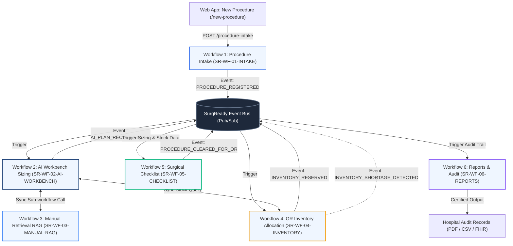
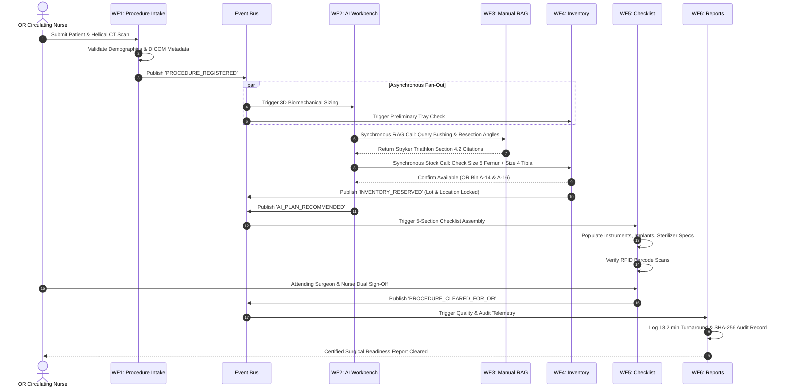

# SurgReady AI — SNS Agent Workbench Multi-Workflow Architecture

This directory contains the complete set of separate, interconnected workflows designed for **SNS Agent Workbench** (SNS Square / SNS iHub), mapping directly to every core feature of the **SurgReady AI** healthcare platform.

---

## 1. Architectural Overview & Workflow Mapping



---

## 2. Directory Contents

| File | Purpose | Corresponding Web App Feature |
|---|---|---|
| [`workflow_01_procedure_intake.json`](./workflow_01_procedure_intake.json) | Patient demographics & 3D scan series metadata validator | **New Procedure Wizard** (`/new-procedure`) |
| [`workflow_02_ai_workbench_analysis.json`](./workflow_02_ai_workbench_analysis.json) | 3D biomechanical landmark detection & implant sizing agent | **AI Surgical Workbench** (`/ai-workbench`) |
| [`workflow_03_manual_retrieval_rag.json`](./workflow_03_manual_retrieval_rag.json) | Semantic vector RAG search over Stryker/Zimmer IFUs & manuals | **Surgical Technique Manuals** (`/manuals`) |
| [`workflow_04_inventory_allocation.json`](./workflow_04_inventory_allocation.json) | Depot stock audit, reservation locks & shortage alert router | **Surgical Inventory & Trays** (`/inventory`) |
| [`workflow_05_checklist_verification.json`](./workflow_05_checklist_verification.json) | 5-section checklist assembler, RFID matcher & dual sign-off | **Surgical Safety Checklist** (`/checklist`) |
| [`workflow_06_reports_audit.json`](./workflow_06_reports_audit.json) | Prep turnaround calculator, audit ledger & report exporter | **Analytics & Quality Reports** (`/reports`) |
| [`orchestrator_bus.js`](./orchestrator_bus.js) | Executable Node.js inter-workflow runner & event simulator | *Central Orchestrator* |
| [`orchestrator_bus.py`](./orchestrator_bus.py) | Python async event bus implementation | *Central Orchestrator* |

---

## 3. Inter-Workflow Event Life Cycle (Step-by-Step)



---

## 4. How to Import into SNS Agent Workbench

1. **Log in** to your SNS Agent Workbench workspace.
2. In the **Workflows** navigation pane, click **Create New Workflow** or **Import Blueprint**.
3. Select **Import JSON** and choose each workflow definition file (`workflow_01_procedure_intake.json` through `workflow_06_reports_audit.json`).
4. **Configure Endpoints**:
   - In **Workflow 1**, configure the Webhook Trigger to match your deployment domain (`/api/v1/workflows/procedure-intake`).
   - In **Workflow 3**, connect your vector knowledge collection containing PDF copies of Stryker, Zimmer Biomet, and Medtronic technique manuals.
5. **Verify Inter-Workflow Links**:
   - Confirm that the `node_publish_event` nodes publish to the named topic, and downstream workflows have matching event listener triggers.

---

## 5. Running the Local Multi-Workflow Interaction Simulator

To see all 6 workflows interact in real-time on your local machine:

```powershell
node sns_workbench_workflows/orchestrator_bus.js
```

This will run an end-to-end simulated case intake, trigger 3D landmark analysis, query the RAG manual database, lock inventory reservations, assemble the 5-section checklist, execute the dual clinical sign-off, and commit the quality audit record.
